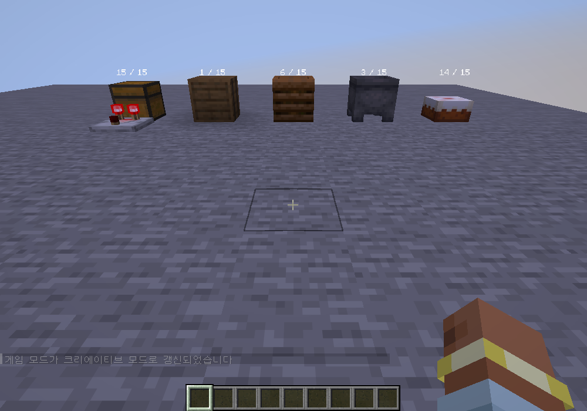
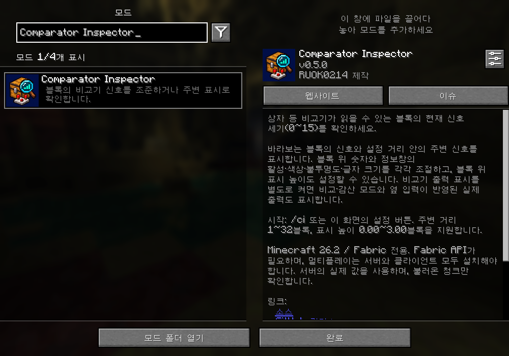
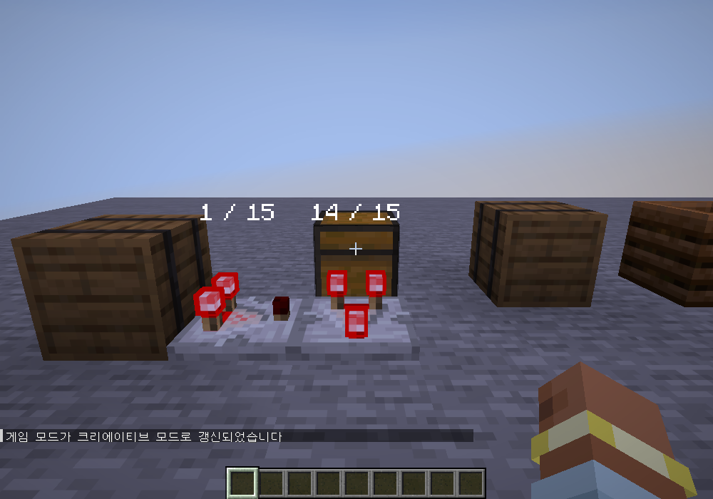

# Comparator Inspector · 비교기 신호 확인


[최신 버전 다운로드](https://github.com/RUOK0214/comparator_inspector/releases/latest) · [릴리스 변경 내역](RELEASE_NOTES.md)

설치된 블록을 비교기가 읽을 때 얻는 **현재 신호 세기(0~15)**를 표시하는 Minecraft 모드입니다.
비교기를 실제로 설치하거나 상자를 열지 않아도 확인할 수 있습니다.
설치된 비교기 위에 **회로의 실제 출력값**을 표시하는 옵션도 제공합니다.





## 설치

- Minecraft Java Edition **26.2**, Java **25 이상**
- Fabric Loader **0.19.5 이상**, Fabric API **0.160.0+26.2 이상**
- `comparator-inspector-0.5.0.jar`를 Fabric API와 함께 `mods` 폴더에 넣습니다. 이전 Comparator Inspector JAR는 제거하고 교체하세요.
- 싱글플레이는 게임에 설치하면 됩니다. 멀티플레이는 **서버와 클라이언트 양쪽**에 설치해야 합니다.
- Mod Menu는 선택 사항입니다. 설치하면 모드 목록의 설정 버튼으로도 설정 창을 열 수 있습니다.
- Mod Menu 목록에 전용 아이콘과 한국어·영어 요약/설명이 표시됩니다. 기능, 사용법, 서버 설치 조건을 확인하고 소스·이슈·릴리스 페이지로 이동할 수 있습니다.
- `-sources.jar`는 개발용 소스이며 설치용이 아닙니다.

## 사용법

채팅창에서 **`/ci`** 또는 **`/comparatorinspector`**를 입력합니다.

| 설정 | 동작 | 기본값 |
| --- | --- | --- |
| 바라보는 블록 표시 | 조준점으로 가리킨 블록의 이름과 신호를 화면에, 숫자를 블록 위에 표시 | 켜짐 |
| 주변 블록 상시 표시 | 시선과 관계없이 거리 안의 지원 블록 위에 숫자 표시 | 꺼짐 |
| 비교기 출력 상시 표시 | 주변 블록 표시와 별개로 거리 안의 비교기 위에 실제 출력(0~15) 표시 | 꺼짐 |
| 주변 표시 거리 | 플레이어 위치에서 블록 중심까지의 반경, 1~32블록 | 8블록 |

탐지 옵션은 동시에 켤 수 있습니다. 탐지 방식·거리 변경은 이 창의 **확인**으로 저장합니다. **취소·Esc**는 아직 확인하지 않은 변경을 버립니다.
비교기 출력은 비교·감산 모드와 옆 입력을 반영합니다. 출력이 없으면 **0 / 15**를 표시합니다.
색상·불투명도·크기·높이는 **블록 위 표시 설정**을 따릅니다. 이 표시를 끄면 비교기 위 숫자도 숨깁니다.
비교기 출력 옵션과 바라보는 블록 표시를 함께 켜면 조준한 비교기의 이름과 출력도 정보창에 표시합니다.
조준한 블록은 노란색, 주변 블록은 흰색 숫자로 표시됩니다. F1로 HUD를 숨기면 숫자도 숨깁니다.
주변 숫자는 벽에 가려지며, 벽 너머를 투시하지 않습니다.
설정 파일은 `config/comparator-inspector.json`입니다.



## 표시별 꾸미기 (0.2.0)

`/ci`의 **블록 위 표시 설정**과 **정보창 표시 설정**에서 각 표시를 독립적으로 조절합니다.

| 항목 | 블록 위 표시 | 정보창 표시 |
| --- | --- | --- |
| 표시 활성 | 블록 위 숫자만 켜기/끄기 | 화면 중앙 아래 정보창만 켜기/끄기 |
| 글자 색상 | 주변/일반 블록의 숫자 색 | 정보창 글자 색 |
| 추가 색상 | 조준한 블록의 숫자 색 | 정보창 배경 색 |
| 불투명도 | 0~100% | 0~100%, 글자와 배경에 함께 적용 |
| 글자 크기 | 50~200% | 50~200% |
| 표시 높이 (0.3.0) | 블록 위 0.00~3.00블록 | 해당 없음 |

**표시 높이**는 `/ci` → **블록 위 표시 설정**에서 조절합니다.
블록이 차지하는 한 칸의 윗면을 기준으로 0.01블록 단위로 조절하며, 기본값은 기존 위치인 **0.18블록**입니다.
조준 표시와 주변 상시 표시 모두 같은 높이를 사용합니다. 케이크 등 낮은 모양의 블록도 한 칸의 윗면을 기준으로 합니다.
표시 설정 창에서 **확인**을 누르면 높이를 포함한 해당 표시 설정이 즉시 저장됩니다. 상위 창에서 다시 저장하지 않아도 됩니다.
0.1.0/0.2.0 설정의 색상·활성·크기 등은 유지하고 새 높이에는 0.18블록을 적용합니다.

색상은 **팔레트, 빨강·초록·파랑 슬라이더, `#RRGGBB` 색상 코드**로 지정합니다.
모든 설정 화면에 **기본값 · 취소 · 확인** 버튼이 있습니다.
- **기본값:** 현재 화면의 항목을 기본값으로 되돌립니다. 색상 선택 창에서는 선택한 색상만 초기화합니다. 아직 저장되지는 않습니다.
- **색상 선택 창의 확인:** 선택한 색을 표시 설정 창으로 전달합니다.
- **블록 위 표시/정보창 설정의 확인:** 그 표시의 설정만 즉시 저장하고 적용합니다. 상위 창에서 다시 확인할 필요가 없습니다.
- **상위 설정창의 확인:** 조준·주변·거리 등 이 창의 변경을 저장합니다. 상위 창의 기본값은 전체 설정을 초기화할 초안을 만듭니다.
- **취소·Esc:** 현재 창의 미확인 변경만 버립니다. 하위 표시 창에서 이미 확인하여 저장한 설정은 상위 창에서 취소해도 유지됩니다.

표시 설정을 확인할 때 다른 표시와 상위 창의 미저장 조준·거리 설정은 함께 저장되지 않습니다. 저장에 실패하면 창을 닫지 않고 안내합니다.
설정 창 안의 예시로 색상·크기·불투명도를 확인할 수 있습니다.

블록 위 표시를 꺼도 정보창은 유지할 수 있고, 정보창을 끄고 블록 위 숫자만 볼 수도 있습니다.
불투명도 0%도 표시를 숨깁니다. 두 표시를 모두 숨기면 신호 조회를 멈춥니다.
기존의 ‘바라보는 블록 표시’, ‘주변 블록 상시 표시’, 거리 설정은 그대로 적용됩니다.
정보창은 조준한 블록을 안내하며, 주변 상시 표시는 블록 위 숫자에 적용됩니다.
큰 정보창은 화면 너비에 맞춰 자동 축소되며, 배경은 100% 설정에서도 기본 80% 불투명도로 표시됩니다.

0.1.0 설정 파일은 자동 호환됩니다. 기존 조준·주변·거리 설정을 유지하면서 새 표시 설정에는 기존 외형을 기본값으로 넣습니다.

## 표시하는 값

블록이 제공하는 게임 자체의 비교기 출력 함수를 서버에서 호출합니다.
상자·큰 상자·통·셜커 상자·호퍼·화로·발사기·공급기 같은 보관 블록과
퇴비통·가마솥·케이크·독서대 등 **게임에서 비교기 출력이 정의된 블록**을 자동으로 인식합니다.
같은 출력을 구현한 다른 모드의 블록도 탐지하지만 개별 모드 호환성은 별도 검증이 필요합니다.

- 빈 상자: **0**, 가득 찬 상자: **15**
- 큰 상자: 두 칸을 합친 실제 보관량으로 계산합니다.
- 상자 위의 막힘 등 게임의 현재 상태도 반영합니다.
- 방향마다 값이 다르면 **북·동·남·서** 값을 따로 표시합니다. 방위는 대상 블록을 기준으로 비교기를 놓는 쪽입니다.
- 상자 등의 표시는 **블록 자체가 비교기에 제공하는 입력 신호**입니다.
- **비교기 출력 상시 표시**는 설치된 비교기가 현재 내보내는 최종 출력을 서버에서 읽습니다. 비교·감산 모드, 옆 입력과 게임의 갱신 지연이 그대로 반영됩니다.
- 아이템 액자·상자 광산 수레 등 **엔티티**는 대상이 아닙니다.

신호는 5게임 틱마다 갱신합니다(정상 속도에서 약 0.25초). 주변의 새 블록 탐지는 20게임 틱마다 진행합니다.
불러온 청크만 검사하며, 가까운 블록 최대 512개를 표시합니다. 한도 초과 시 조준 대상에 우선권을 주고 안내를 표시합니다.
서버 지연 중에는 갱신이 늦어질 수 있고, 오래된 값은 숨깁니다.

서버에 모드가 없으면 설치 안내를 표시합니다. **알 수 없는 값을 0으로 표시하지 않습니다.**
아직 내용물이 생성되지 않은 자연 생성 전리품 상자는 조회로 전리품을 생성하지 않도록 건너뜁니다.
이 경우 조준 표시에는 ‘신호 확인 중 / 정보 없음’이 나옵니다. 상자를 정상적으로 연 뒤에는 조회할 수 있습니다.
불러오지 않은 청크 경계에 인접한 블록도 읽기를 보류할 수 있습니다.

## 개발 및 검증

```text
gradlew.bat build
gradlew.bat runClientGameTest
```

게임 통합 테스트는 별도 임시 월드에서 빈 상자·아이템 변경·가득 찬 상자·위가 막힌 상자·큰 상자의 값,
실제 비교기와의 일치, 퇴비통·가마솥·케이크, 조준/주변 모드, 거리 제한,
설정 저장·취소, 블록 교체, 전리품 보존, 불러오지 않은 청크, 높이 경계와 접속 종료를 검증합니다.
한국어 설정 화면 및 조준/주변 표시 스크린샷도 생성합니다.
0.2.0 테스트는 표시별 활성 분리, 색상·크기·불투명도 적용, 저장·취소, 잘못된 색상 코드,
기존 설정 호환, 작은 화면 배치와 탐지 설정 변경 후 색상 보존을 추가로 검증합니다.
0.3.0 테스트는 높이 슬라이더, 높이 저장·취소, 이전 설정 호환, 최소/최대 높이의 실제 표시 위치,
조준·주변 표시 공통 적용과 작은 화면에서의 높이 설정 배치를 검증합니다.
0.4.0 테스트는 실제 Mod Menu에서 한국어·영어 설명과 아이콘 로딩, 설정 버튼, 영문 기본 설명을 검증합니다.
GitHub Actions에서도 빌드와 게임 통합 테스트를 실행하며, 모두 성공하면 설치 JAR·ZIP·SHA-256 파일을 릴리스합니다.

기술 참고: [Fabric 네트워킹](https://docs.fabricmc.net/develop/networking),
[Fabric 월드 렌더링](https://docs.fabricmc.net/develop/rendering/world).

MIT 라이선스.

0.4.1 테스트는 색상별 기본값, 표시 설정 즉시 저장, 상위 취소 후 저장 유지, 미저장 탐지 설정 분리와 다른 표시 보존을 검증합니다.
0.5.0 테스트는 비교기 표시의 독립 활성·저장·해제, 비교/감산 모드, 옆 입력, 0·1·14·15 출력,
거리 제한, 표시 높이·색상·활성 적용, 비교기 교체, 이전 설정 호환과 작은 화면 배치를 검증합니다.
